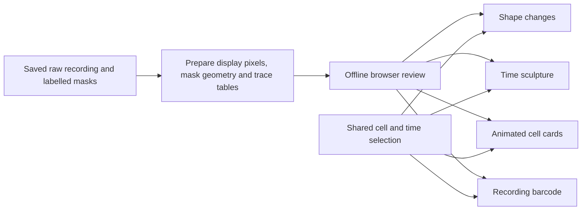

# Four linked views of saved microglial cells

## End goal

Open one offline browser review per recording and inspect mask gains and losses, a rotating stack of outlines through time, animated cell cards with signal and area traces, and a clickable recording barcode. All four views share the selected cell and native recording frame. Export the ten accepted CD68 recordings as a new version and preserve their saved identity histories and prior outputs.

## Why

Movies alone make it difficult to follow shape changes or connect an interesting frame to its cell trace. The linked views make those comparisons immediate while preserving the accepted masks and identities as the source of every display.

## Architecture

Like four windows onto the same recording, each view reads one frozen review payload.

Preparation belongs in PyMicroglia's figure_tables package; browser rendering belongs in visualisation. The export is a self-contained local HTML document with no network dependency. This is package-specific display work, consuming the saved Motion labels rather than changing another package.

## Stage map

| NN | Name | Goal | Rough size | Depends on |
|---|---|---|---|---|
| 01 | Frozen review data and portable export | All four displays need one consistent source of cell identity, mask geometry, time and original signal. Establish that source before any view so selecting a cell can never change its tracking history. | one preparation and export slice | none |
| 01a | Display preparation boundaries | Move existing calculations outside rendering; preserve behavior. | small prerequisite repair | 01 |
| 02 | Shape change weather map | Mask gains and losses are easier to spot as coloured pixels than as competing outlines. The view should let the user distinguish changes in the recording coordinates from changes after centring the same cell. | one linked display slice | 01 |
| 03 | Rotatable time sculpture | Stacking the saved outlines with time as height exposes movement and shape history at a glance. Rotation should reveal that history without inventing an outline between observations. | one three-dimensional display slice | 01, 02 |
| 04 | Animated cell cards and synchronized traces | Linking sharp cell movies to signal and mask-area traces makes an interesting trace point immediately inspectable. Several pinned cards support comparisons without altering the underlying measurements. | one card display slice | 01, 02 |
| 05 | Clickable recording barcode and reusable action | A row for every established cell exposes recording-wide changes and missing observations. Registering the exporter makes the four views reusable for new analyses and other reporters without manually assembling files. | one recording navigation and API slice | 01, 02, 03, 04 |
| 06 | Accepted recording exports and completion evidence | The views need to work on the accepted recordings, not just small fixtures. A separate version, verified source fingerprints, browser checks and an opened review make the result usable immediately. | one full-data delivery slice | 01, 02, 03, 04, 05 |

## House rules

Read AGENTS.md and respect the sibling consolidation map. Read raw sources and labels only; never rerun tracking, refine masks, assign identities, fill mask gaps, or write back to inputs. Keep native frame offsets and sampling times explicit. Display pixels have fixed recording-wide contrast, no denoising and nearest-neighbour enlargement. Motion trails remain off by default. Missing observations are blank, not zeros. New outputs go in development/cd68_v5; preserve earlier versions. Saved standalone figures go through plot-that; the interactive webpage contains its own dashboard charts. Keep Python visualisation files under 600 lines and place preparation outside the rendering package. Run focused gates after each stage, record their evidence, mark stages _COMPLETED, and finalize only after all gates pass. The user has authorized writing and executing the full conversational plan, so no intermediate approval is required.

## How to run

Use /do-step docs\cell-review-views.
